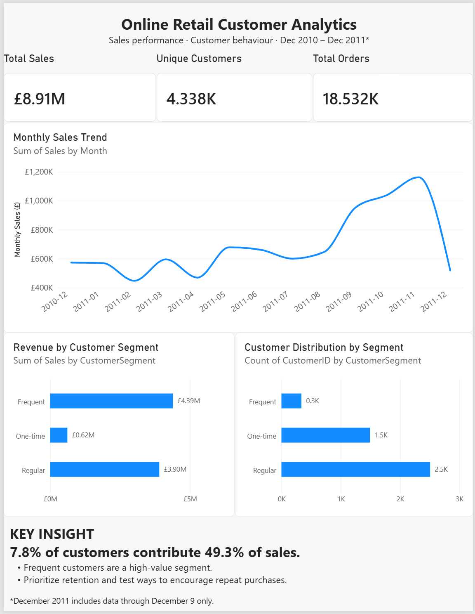

# Online Retail Customer Analytics

## Project Overview

This project analyzes an online retail transaction dataset using SQL and Power BI to explore sales performance, customer purchasing behavior, and customer segmentation.

## Business Questions

- How did monthly sales change over time?
- How many unique customers and orders were recorded?
- How do customer segments differ in size and revenue contribution?
- Which customer segments may deserve greater retention focus?

## Tools

- SQL
- Microsoft Power BI
- Power Query
- DAX

## Dashboard Preview

## Key Findings

- Total sales in the analyzed dataset were approximately **£8.91 million**.
- The analysis covered **4,338 identified customers** and **18,532 distinct invoices**.
- Frequent customers represented approximately **7.8% of customers** and contributed approximately **49.3% of sales**.
- November 2011 had the highest monthly sales in the analyzed period, at approximately **£1.16 million**.

## Data Preparation

The analysis focused on positive-quantity sales with positive unit prices, non-cancelled invoice numbers, and non-missing customer IDs for customer-level metrics.

Records with missing customer IDs were retained in the source data but excluded from customer segmentation because they could not be assigned to an identified customer.

December 2011 is a partial month; the dataset ends on December 9, 2011.

## Business Recommendations

- Prioritize retention initiatives for frequent customers.
- Test campaigns designed to encourage one-time customers to make repeat purchases.
- Monitor monthly sales and customer-segment revenue to identify changes in purchasing behavior.

## Data Source

Chen, D. (2015). *Online Retail*. UCI Machine Learning Repository.

Dataset: https://doi.org/10.24432/C5BW33

## Limitations

This is a historical transactional dataset. The recommendations are analytical hypotheses and have not been validated through controlled marketing experiments.